# Architecture

This document defines the structural invariants of this repository. Automated checks (`npm run check`) enforce these rules on every change.

## System Flow: Startup and Query Time

`./serve` separates indexing work (once at startup) from search and writing work (on each `POST /ask`).

<picture>
  <source media="(prefers-color-scheme: dark)" srcset="docs/assets/architecture-dark.svg" />
  <source media="(prefers-color-scheme: light)" srcset="docs/assets/architecture-light.svg" />
  
</picture>

**How to read this diagram:** The top box runs once at startup. It reads 21,612 JSON files, chunks them, builds deterministic links, embeds each chunk, and writes one SQLite file plus a 119 MiB in-memory vector array. The bottom box runs on each `POST /ask` query: a bounded agent calls up to four local SQLite tools (max 5 turns), writes a grounded answer, and strips any citation it did not read.

### Key Runtime Design Points (In Plain Terms)

- **Deterministic Link Graph, not LLM-built GraphRAG:** We do not pay an LLM to summarize 21,600 **Corpus Documents** at startup. Instead, our parser extracts existing ticket IDs, PR links, URLs, and 6 entity types directly from JSON into SQLite, and `expand_graph` walks 1 to 2 hops at query time for \$0 ingest cost.
- **Safe parameterized filtering, never raw SQL:** The agent passes typed JSON filters to `filter_metadata`. Our code validates field paths against a strict allowlist pattern and runs a parameterized SQLite query returning matching documents and an exact `total_count`.
- **Schema Catalog for unseen corpora:** At startup, our code summarizes each source's common metadata keys and enum values into a compact 3.5 KB **Schema Catalog** (for example, showing Google Drive uses `"final"`, not `"finalized"`). The agent reads this catalog in its prompt so it does not guess field names on an unseen corpus.
- **Routing vs. Synthesis split:** Each query separates *tool routing* (deciding what to search, filter, or read next) from *final synthesis* (writing the grounded answer from the read documents). In our promoted **Run Profile** (`eval/profiles/prod.json`), both roles use `gemini-3.8-flash`. Ablations showed routing intelligence drives quality far more than synthesis model size.

## Five-Layer Clean Architecture

Source code under `src/` is split into five unidirectional layers. Each layer may import only from itself and earlier layers. `dependency-cruiser` enforces this contract mechanically (`npm run arch`).

```text
src/
├── utils/       Pure helpers, hashing, math (cosine similarity), deterministic ID/text utils. No I/O, no business context.
├── models/      Zod schemas, domain types, hyperparameter config types, custom error classes.
├── adapters/    External I/O ports and implementations: SQLite (better-sqlite3 FTS5), Gemini / Vercel AI SDK, optional Ollama adapter, filesystem corpus reader.
├── usecases/    Core logic: incremental ingestion, deterministic graph builder, hybrid retrieval, search-first bounded agent loop, citation pruning, eval runner.
└── services/    Thin runnable entrypoints: HTTP server (`GET /health`, `POST /ask`), `./serve` bootstrap, CLI runners. Services must not import each other.
```

## Non-Negotiable Invariants

- **Strict unidirectional dependencies:** `utils` -> `models` -> `adapters` -> `usecases` -> `services`. Upward imports and circular dependencies fail `npm run arch`.
- **Service independence:** Entrypoints under `src/services/` cannot import sibling services. Shared logic belongs in `src/usecases/`.
- **Strict TypeScript:** `strict: true`, `noUncheckedIndexedAccess: true`, `exactOptionalPropertyTypes: true`, zero `any`. Parse external JSON (corpus files, HTTP bodies, LLM responses) with `zod`.
- **Explicit errors:** Use typed error subclasses from `src/models/errors.ts`. Never swallow rejections or return silent fallback values.
- **Test honesty (`@interfere/landmines`):** No fixed sleeps, no flake retries, no conditional assertions, no mocking the system under test. Test real SQLite databases in temp directories and real HTTP contracts.
- **Incremental-ready storage:** Key every document, chunk, embedding, and graph edge by `(dataset_doc_uuid, content_hash)` so live document updates and deletes require atomic upserts rather than full re-indexing.
- **Runtime portability (`docs/api-contract.md`):** Target plain `node` (20+) and `npm` for `./serve`. Use `better-sqlite3` (FTS5 enabled) instead of `node:sqlite` (which lacks FTS5). Keep all runtime dependencies inside `package-lock.json` and verify cold start in a `node:20-slim` container.
- **Strict credential boundary:** Default `./serve` reads only `CORPUS_DIR`, `PORT`, and `GEMINI_API_KEY`. Optional local models (for example, Ollama `clef-flash`) or external gateways stay strictly opt-in behind adapter config for dev and comparative benchmarking.

## Repository Layout

```text
.
├── AGENTS.md                 Project values, principles, and agent rules (CLAUDE.md symlinks here)
├── ARCHITECTURE.md           Layer rules and invariants (this file)
├── docs/api-contract.md    Fixed HTTP and runtime contract
├── README.md                 Project overview, benchmarks, and quickstart
├── docs/
│   ├── assets/               Light/dark standalone SVGs for README and Architecture docs
│   ├── stack-decision.md     Weighted Python vs. TypeScript decision matrix
│   ├── rag-research.md       Primary-source SOTA RAG, GraphRAG, and compute benchmarks
│   ├── langfuse-observability.md  Langfuse v4 OTel & experiment guide
│   └── index.html            Offline interactive benchmark report (GitHub Pages)
├── eval/
│   ├── profiles/             Versioned L0->L3 + prod Run Profiles
│   └── onyx/                 Committed MIT EnterpriseRAG-Bench results
├── scripts/
│   └── generate-splits.ts    Deterministic re-seedable stratified splitter
├── src/                      5-layer TypeScript Clean Architecture
└── tests/                    Unit, contract, and eval-integrity tests
```
