# sqlite-rag-bench

[](https://github.com/ebragas/sqlite-rag-bench/actions/workflows/ci.yml) [](LICENSE) [](package.json) [](ARCHITECTURE.md)

A local-first enterprise RAG engine and evaluation harness built in strict TypeScript on Node 20+. Everything runs out of a single SQLite file (FTS5 keyword search + contiguous in-memory `Float32Array` dense vectors + zero-LLM deterministic **Link Graph**), paired with a controlled `L0 -> L3` evaluation harness, unbiased `pass@k` / `pass^k` consistency testing, and opt-in **Langfuse v4** real-time OpenTelemetry tracing.

Benchmarked against all **500 public MIT-licensed questions** from [Onyx EnterpriseRAG-Bench](https://github.com/onyx-dot-app/EnterpriseRAG-Bench) across 9 enterprise sources (Slack, Gmail, Linear, Google Drive, HubSpot, Confluence, Fireflies, Jira, GitHub).

> **Interactive Benchmark Report:** Open [`docs/index.html`](docs/index.html) offline in any browser (or enable GitHub Pages on `/docs`) for interactive category charts, paired `L0` vs. `prod` comparisons, and `pass@k` / `pass^k` curves.

---

## Why Local-First SQLite?

Most enterprise RAG stacks start by standing up a vector database, a graph database, and an orchestration service before proving retrieval quality. `sqlite-rag-bench` tests how far a single-process, zero-daemon architecture can go on modest CPU-only hardware (`<= 4 GiB` RAM):

- **Single SQLite file (`.cache/brain-<hash>.sqlite`):** Stores documents, chunks, FTS5 BM25 index (AND-first with OR backfill), promoted metadata columns + `metadata_json`, a 3.5 KB per-source **Schema Catalog**, a deterministic **Link Graph**, and raw embedding blobs.
- **Exact CPU vector search in ~25 ms:** 38,774 chunks at 768 dims (`gemini-embedding-2`) load into one contiguous `Float32Array` (**119 MiB** RAM) with zero external vector daemon.
- **Incremental-ready storage:** Every document, chunk, embedding, alias, and edge is keyed by `(dataset_doc_uuid, content_hash)` for atomic upserts and deletes.
- **Bare Linux verified:** Runs unattended in bare `node:20-slim` (no `gcc`, `g++`, `make`, or `python3`), indexing 21,612 documents in **15.0 min** on a Tier 1 API key (faster on Tier 2/3 via adaptive TPM pacing) at **1.3 GiB** peak RSS and shutting down in **85 ms** on `SIGTERM`.

---

## Architecture

<picture>
  <source media="(prefers-color-scheme: dark)" srcset="docs/assets/architecture-dark.svg" />
  <source media="(prefers-color-scheme: light)" srcset="docs/assets/architecture-light.svg" />
  
</picture>

**How to read this diagram:** The top box runs once at startup. It reads 21,612 JSON files, chunks them, builds deterministic links, embeds each chunk, and writes one SQLite file plus a 119 MiB in-memory vector array. The bottom box runs on each `POST /ask` query: a bounded agent calls up to four local SQLite tools (max 5 turns), writes a grounded answer, and strips any citation it did not read.

See [`ARCHITECTURE.md`](ARCHITECTURE.md) for the five-layer unidirectional dependency rules (`utils -> models -> adapters -> usecases -> services`) enforced by `dependency-cruiser`.

---

## Quickstart (2-Minute Demo)

A small, self-contained 8-document multi-source demo corpus lives in [`data/demo/`](data/demo/) so you can test `./serve`, `npm run ask`, and `npm run eval` right after cloning.

```bash
git clone https://github.com/ebragas/sqlite-rag-bench.git
cd sqlite-rag-bench
npm install

# 1. Run all mechanical quality gates (oxlint, tsc, dependency-cruiser, 161 vitest tests)
npm run check

# 2. Ask a question interactively with live tool calls, citations, latency, and cost
GEMINI_API_KEY="your-key" npm run ask -- \
  --corpus data/demo/corpus \
  "My parent is having surgery. How many weeks of paid leave do I get?"

# 3. Start the HTTP server on the demo corpus
PORT=8080 CORPUS_DIR="$PWD/data/demo/corpus" GEMINI_API_KEY="your-key" ./serve
```

Query the running server:

```bash
curl -s -o /dev/null -w '%{http_code}\n' http://127.0.0.1:8080/health
curl -s http://127.0.0.1:8080/ask \
  -H 'Content-Type: application/json' \
  -d '{"question": "How many HubSpot accounts are in the qualified stage, and which one is enterprise tier?"}'
```

---

## Reproducing the Onyx EnterpriseRAG-Bench Evaluation

1. Download the 500 MIT-licensed public questions from [Onyx EnterpriseRAG-Bench](https://github.com/onyx-dot-app/EnterpriseRAG-Bench):
   ```bash
   npm run download:onyx
   ```
2. Unpack the MIT-licensed corpus source folders under `data/corpus/<source>/`.
3. Run evaluations against any versioned **Run Profile** (`eval/profiles/l0-fts.json`, `l1-filters.json`, `l2-hybrid.json`, `l3-graph.json`, `prod.json`):
   ```bash
   # Single-pass keyword baseline (L0)
   npm run eval -- --profile l0-fts --split dev --in-process --concurrency 8 --judge gemini-4-neon

   # Promoted hybrid + Link Graph + Turn 0 pre-search profile (prod)
   npm run eval -- --profile prod --split dev --in-process --concurrency 8 --judge gemini-4-neon

   # Regenerate the offline interactive HTML report (docs/index.html)
   npm run report
   ```

---

## Benchmark Results (Onyx EnterpriseRAG-Bench, 500 Public Questions)

Evaluated all **500 official MIT-licensed questions** from [onyx-dot-app/EnterpriseRAG-Bench](https://github.com/onyx-dot-app/EnterpriseRAG-Bench) over a 21,612-document multi-source corpus slice (all 9 enterprise sources, 38,774 chunks, 100% expected-document coverage; smaller distractor set than Onyx's 511K full corpus). Scored by an independent `gemini-4-neon` **Judge** under Onyx contradiction zeroing (`0.70` Answer Score + `0.30` Citation F1), with live **Langfuse v4** OpenTelemetry tracing (`eval/onyx/benchmark-summary.json`, interactive charts in [`docs/index.html`](docs/index.html)).

### Benchmark Context: Best Profile (`prod`) vs. Public Onyx Reference Systems

<picture>
  <source media="(prefers-color-scheme: dark)" srcset="docs/assets/leaderboard-context-dark.svg" />
  <source media="(prefers-color-scheme: light)" srcset="docs/assets/leaderboard-context-light.svg" />
  
</picture>

**How to read this chart:** The green bar is our best profile (`prod`) across all 500 official Onyx questions (`88.0%` overall, or `89.2%` on the 490 standard-labeled questions with `0 / 500` invalid citations), ranked by score alongside seven published [Onyx EnterpriseRAG-Bench Leaderboard](https://huggingface.co/spaces/onyx-dot-app/EnterpriseRAG-Bench-Leaderboard) systems. Note the scale tag under each name: public leaderboard systems ran on the full 511,000-document corpus with Onyx's official scorer, while our runs used a 21,612-document slice (~24x fewer distractors) and a `0.70 Answer + 0.30 Citation F1` composite score.

### Full 500-Question Results (`prod`: `gemini-3.8-flash` at `temperature: 0`, `gemini-embedding-2` 768d)

| Onyx Category | Questions | Composite | Answer | Citation F1 | Fabrications | False Abs. | Invalid Cit. |
| :--- | ---: | ---: | ---: | ---: | ---: | ---: | ---: |
| `info_not_found` | 20 | **100.0%** | 100.0% | 100.0% | 0 | 0 | 0 |
| `miscellaneous` | 20 | **99.2%** | 99.5% | 98.3% | 0 | 0 | 0 |
| `intra_document_reasoning` | 40 | **97.4%** | 97.7% | 96.7% | 0 | 1 | 0 |
| `basic` | 175 | **96.6%** | 96.7% | 96.2% | 3 | 0 | 0 |
| `constrained` | 30 | **96.2%** | 95.8% | 97.3% | 1 | 0 | 0 |
| `conflicting_info` | 20 | **87.7%** | 91.8% | 78.3% | 1 | 0 | 0 |
| `semantic` | 125 | **78.4%** | 78.2% | 78.8% | 9 | 16 | 0 |
| `project_related` | 40 | **78.3%** | 75.1% | 85.8% | 3 | 0 | 0 |
| `completeness` | 20 | **67.8%** | 68.5% | 66.2% | 1 | 4 | 0 |
| `high_level`\* | 10 | **30.0%** | 30.0% | 30.0% | 7\* | 0 | 0 |
| **All 500 Official Questions** | **500** | **88.0%** | **88.0%** | **88.1%** | **25** | **21 (4.5%)** | **0** |

*\*Note on `high_level`: Onyx's 10 broad thematic `high_level` questions leave `expected_doc_ids: []` even though they are answerable. Because our harness treats empty `expected_doc_ids` as `unanswerable`, answering 7 of those 10 questions was penalized as fabrication. Across the 490 questions with standard ground-truth labels, Composite Score is **89.2%** with **100.0% Abstention Recall (`20 / 20` on `info_not_found`)** and **0 / 500 Invalid Citations** (latency p50 **26.5 s**, p95 **61.3 s**).*

### Paired Ablation: Single-Pass Keyword Baseline (`l0-fts`) vs. `prod` (100 Stratified Questions, 10 per Category)

<picture>
  <source media="(prefers-color-scheme: dark)" srcset="docs/assets/onyx-categories-dark.svg" />
  <source media="(prefers-color-scheme: light)" srcset="docs/assets/onyx-categories-light.svg" />
  
</picture>

**How to read this chart:** This is an apples-to-apples before-and-after test on the exact same 100 questions (10 from each Onyx category). Each hollow circle is our simple keyword-only baseline (`l0-fts`, `78.9%` overall). Each solid green circle is our best profile (`prod`, adding semantic vectors and the Link Graph, `83.0%` overall). The line connecting them shows the gain or drop per question type. *(The overall average is `83.0%` instead of `88.0%` because this test weights all 10 categories equally, while easier `basic` questions make up 35% of the full 500-question set.)*

- **Overall paired gain:** **83.0%** `prod` vs. **78.9%** `l0-fts` (**+4.0%**), cutting **False Abstentions** in half (**7.5% -> 3.8%**).
- **Biggest category wins:** `semantic` (**+17.7%**, 60.0% -> 77.7%), `project_related` (**+11.4%**, 74.4% -> 85.8%), `high_level` (**+10.0%**), `constrained` (**+3.9%**, 88.1% -> 92.0%), and `completeness` (**+3.7%**).

### Hard-Slice Consistency (`pass@1..5` vs. `pass^1..5`, 20 Hard Questions x 5 Trials = 100 Runs)

<picture>
  <source media="(prefers-color-scheme: dark)" srcset="docs/assets/reliability-k5-dark.svg" />
  <source media="(prefers-color-scheme: light)" srcset="docs/assets/reliability-k5-light.svg" />
  
</picture>

**How to read this chart:** LLMs can give different answers to the same question, so we ran our best profile (`prod`) 5 separate times on 20 hard questions (100 total runs at `temperature: 0`). The horizontal axis (`k = 1` to `k = 5`) is the number of tries per question. **Blue (`Strict pass@k`, `90% -> 100%`)** shows how many hard questions scored `>= 80%` *at least once* in `k` tries. **Green (`Strict pass^k`, `90% -> 80%`)** shows how many passed on *every single try* in a row. **Brown dashed (`Safety pass^k`, `95% -> 90%`)** tracks zero fabrications, zero invalid citations, and zero false refusals on every try. **Gray (`Perfect pass^k`, `34% -> 30%`)** tracks an exact `100%` score on every try.

Evaluated 5 fresh trials on 5 questions each from `conflicting_info`, `completeness`, `project_related`, and `info_not_found` (`temperature: 0`, `gemini-4-neon` Judge):

- **Mean Composite across 5 trials:** **88.1% (&plusmn; 0.98%)** (trial range: 87.2% to 89.8%).
- **Strict Pass (`>= 80%`, 0 fabrications, 0 Invalid Citations):** `pass@1` **90.0%**, `pass@5` **100.0%**, `pass^3` **84.0%**, `pass^5` **80.0%**.
- **Safety across 100 hard runs:** `Safety pass^5` **90.0%** (**0 / 100 Invalid Citations**, 1 fabrication, 4 False Abstentions).
- **Total spend across all 700 benchmark evaluations:** **\$45.72** (\$33.83 Responder + \$11.88 Judge).

---

## Langfuse v4 Observability

Add optional Langfuse keys to `.env` (gitignored) to export real-time OpenTelemetry spans (`x-langfuse-ingestion-version: 4` via `@langfuse/otel@6.1.1`) and `langfuse.experiment.run` evaluations with 27 item and run scores plus cross-process W3C `traceparent` stitching.

See [`docs/langfuse-observability.md`](docs/langfuse-observability.md) for the full trace hierarchy and setup guide.

---

## Mechanical Quality & Verification

- `npm run check`: `oxlint` (`@interfere/landmines`), `tsc --noEmit` (`strict`, `noUncheckedIndexedAccess`, zero `any`), `dependency-cruiser` (5-layer Clean Architecture), and `vitest` (27 test files, 161 tests).
- `npm run verify:docker -- --live-ask`: Verifies clean-archive startup inside bare `node:20-slim` (zero C++ build tools, minimal env vars, `503 -> 200`, concurrency 4, peak RSS `<= 4 GiB`, clean `SIGTERM` shutdown).

## License

MIT License. See [`LICENSE`](LICENSE). Benchmark questions and corpus derive from MIT-licensed [onyx-dot-app/EnterpriseRAG-Bench](https://github.com/onyx-dot-app/EnterpriseRAG-Bench).
