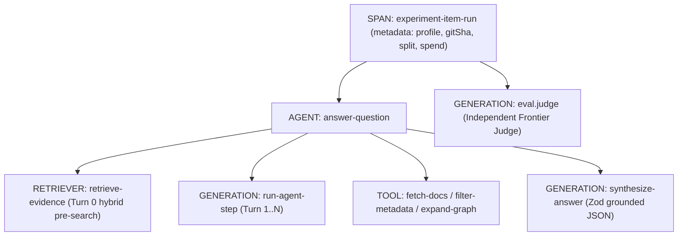

# Langfuse v4 Observability & Experiment Tracing

`sqlite-rag-bench` ships opt-in, real-time OpenTelemetry tracing and experiment reporting to **Langfuse Cloud v4** (or self-hosted Langfuse v4).

All Langfuse and OpenTelemetry packages live strictly in `devDependencies` (`@langfuse/client`, `@langfuse/otel`, `@langfuse/tracing` at `^6.1.1`) and are lazily imported only when credentials are present. Production `./serve` runs cleanly with zero observability dependencies when keys are unset.

## Quick Setup

Add your Langfuse keys to `.env` (gitignored, loaded by dev CLIs `npm run eval` and `npm run ask`):

```bash
GEMINI_API_KEY="your-gemini-key"
LANGFUSE_PUBLIC_KEY="pk-lf-..."
LANGFUSE_SECRET_KEY="sk-lf-..."
LANGFUSE_BASE_URL="https://us.cloud.langfuse.com"   # or https://cloud.langfuse.com for EU
```

Then run any interactive query or evaluation:

```bash
npm run ask -- --corpus data/demo/corpus "What Postgres version does Billing Ledger use?"
npm run eval -- --profile prod --split dev --in-process --concurrency 4 --judge gemini-4-neon
```

## What Gets Traced (Real-Time v4 OTLP Ingestion)

`@langfuse/otel@6.1.1` automatically sets `x-langfuse-ingestion-version: 4` and `x-langfuse-sdk-version: 6.1.1` on every OTLP export. CLI runs use `exportMode: "immediate"` and flush before process exit so no spans are lost.

Each evaluated question produces a single nested trace tree:



## Key Implementation Details (`src/adapters/telemetry.ts` & `src/adapters/langfuse-exporter.ts`)

1. **Cross-process W3C `traceparent` propagation:** When `npm run eval` targets a live `./serve` HTTP process (`--url http://127.0.0.1:8080`), the harness injects `traceparent` headers and the server extracts them so client, server, tool, and Judge spans stitch into one trace.
2. **Local-array `langfuse.experiment.run`:** Evaluations stream local split arrays directly into `experiment.run` with stable item IDs and full **Run Profile** + `gitSha` + `indexConfigHash` metadata, keeping private or held-out test sets out of cloud datasets.
3. **27 structured scores per run:** Item-level scores (`composite_score`, `answer_score`, `citation_score`, `abstained`, `false_abstention`, `invalid_citations`) plus run-level aggregates (`latency_p50_ms`, `latency_p95_ms`, `spend_*_usd`, and per-stratum breakdowns) are exported directly to Langfuse Scores v3.
4. **Strict attribute sanitization:** Propagated trace metadata enforces Langfuse's 200-character JSON-encoded attribute limit (`filterPropagatableMetadata`) and falls back to the `"langfuse-sdk"` tracer scope if `@langfuse/tracing` is absent.
